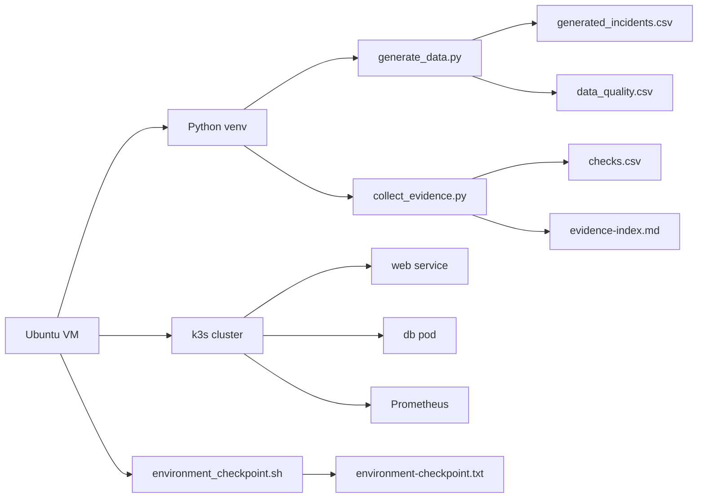

# Architecture

The kickoff keeps analysis on the VM host from the Python virtual environment. The existing statustracker app, database, and Prometheus remain the course environment. Week 11 adds a repeatable data generation and evidence path beside that environment.

Week 12 will use the generated dataset to produce analysis CSV files, charts, and a statistical check. Week 13 will turn those outputs into the report for Dana.
